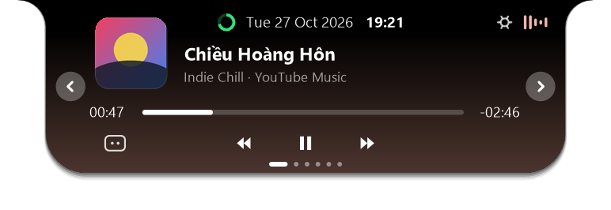
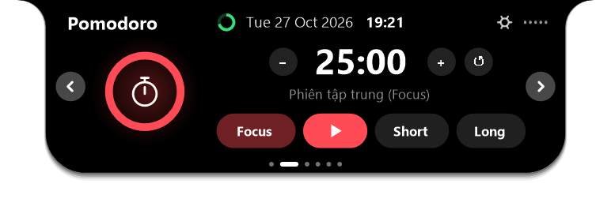
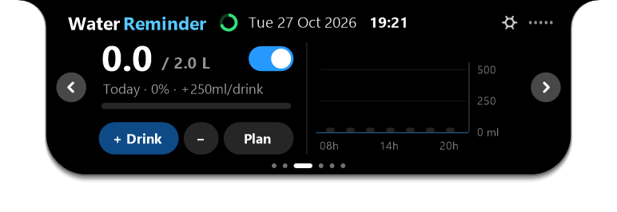
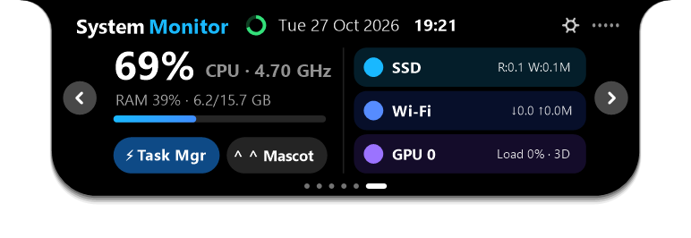
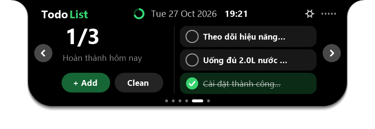
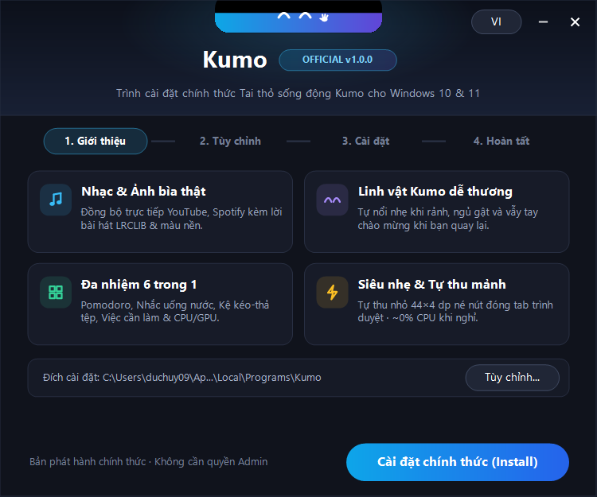
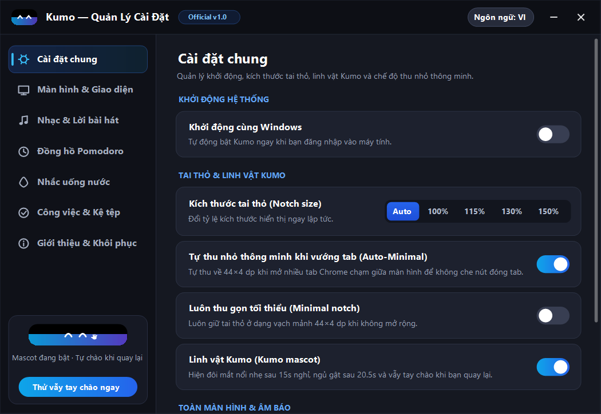

<div align="center">
  
  <h1>Kumo</h1>
  <p><b>Tai thỏ sống động thông minh cho Windows 10 & 11 · Official Living Notch for Windows</b></p>
  <p>
    <a href="https://github.com/buiduchuy2010qn-prog/kumo/releases/latest/download/KumoSetup.exe">
      
    </a>
    
    
  </p>
</div>

---

## ✨ Tính năng nổi bật (Highlights)

- 🎵 **Nhạc & Ảnh bìa thật (WinRT SMTC + LRCLIB)**: Tự động đọc trạng thái phát nhạc, ảnh bìa Album / Thumbnail YouTube từ Spotify, Chrome, Edge, Firefox, Cốc Cốc... kèm quầng sáng màu nền chuyển sắc, thanh tua nhạc trực tiếp và lời bài hát đồng bộ từng câu.
- ☁️ **Linh vật Kumo sống động**: Đôi mắt Kumo tự nổi nhẹ nhàng khi bạn rời máy, ngủ gật sau 20 giây và vẫy tay chào mừng khi bạn quay trở lại.
- ➖ **Tự thu mảnh thông minh (Smart Auto-Minimal)**: Tự động thu gọn về vạch mảnh `44×4 dp` khi mở nhiều tab trình duyệt chạm giữa màn hình để không bao giờ che nút đóng tab.
- ⏱ **6 trang tiện ích tương tác đầy đủ**:
  1. **Music & Synced Lyrics**: Tua giây trực tiếp trên thanh tiến trình, nhấp câu hát để nhảy đoạn, nhấp bìa nhạc để mở trình phát.
  2. **Pomodoro Timer**: Chỉnh nhanh thời lượng `− / +`, vòng đếm ngược trực quan, chế độ `Focus / Short / Long`.
  3. **Water Reminder**: Công tắc nhắc nước, cộng/trừ nhanh lượng nước, chỉnh kế hoạch ngay trên tai thỏ & biểu đồ cột theo giờ.
  4. **File Shelf**: Kệ lưu trữ tệp kéo-thả 2 chiều, mở nhanh tệp hoặc kéo sang ứng dụng khác.
  5. **TodoList**: Danh sách việc cần làm hỗ trợ cuộn chuột và thêm nhanh ngay dưới tai thỏ.
  6. **System Monitor**: Theo dõi thời gian thực `CPU`, `RAM`, `SSD`, `Wi-Fi` và `GPU 0`.
- ⚙️ **Bảng Quản Lý Cài Đặt & Trình Cài Đặt Chính Thức (`KumoSetup.exe`)**: Hỗ trợ song ngữ **Tiếng Việt / English**, tích hợp Start Menu, Windows Search, khởi chạy cùng Windows và gỡ cài đặt sạch sẽ qua `Uninstall.exe`.

---

## 📸 Giao diện thực tế (Screenshots)

<div align="center">
  
  <br/><br/>
  
  
  <br/>
  
  
  <br/>
  
  <br/><br/>
  
  
</div>

---

## 🚀 Cài đặt nhanh (Installation)

1. Tải trực tiếp **[KumoSetup.exe (Official v1.0.0)](https://github.com/buiduchuy2010qn-prog/kumo/releases/latest/download/KumoSetup.exe)** ở mục **Releases**.
2. Mở `KumoSetup.exe` → Bấm **Cài đặt chính thức (Install)** (không yêu cầu quyền Admin).
3. Mở **Kumo** bất kỳ lúc nào từ **Start Menu** hoặc thanh tìm kiếm Windows.

---

## 🛠️ Tự biên dịch từ mã nguồn (Zero-Dependency Build)

Không cần cài đặt Visual Studio hay SDK nặng — sử dụng trực tiếp trình biên dịch `.NET Framework 4.x` có sẵn trên mọi máy Windows 10/11 (hoặc chạy tự động trên đám mây qua **GitHub Actions**):

```powershell
powershell -ExecutionPolicy Bypass -File .\build.ps1
```